## Данные

- **Иерархическая модель** данных, в которой данные связанны в древовидную структуру
- **Сетевая модель** данных, в которой связи между данными могут пересекаться друг с другом
- **Реляционная модель** данных, в основе которой лежит привычная нам двумерная таблица объединяет в себе иерарическую и сетевую модели.

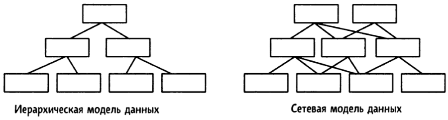

**Иерархическая модель** данных имеет элемент "потомок", которым имеет только одного "предка". Реляционная БД позволяет обрабатывать данные с помощью двумерной таблицы - простой и привычной для понимания концепции.

Реляционная модель данных:
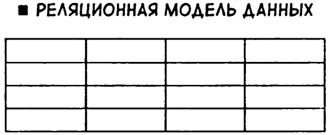

Для примера возмём двумерную таблицу
```markdown
| Код товара | Название товара | Цена | Примечание |
----------------------------------------------------
|101         | Дыни            | 800  | С семечками|
|102         | Клубника        | 150  |            |
|103         | Яблоки          | 120  |            |
|104         | Лимоны          | 120  | Кислые     |
```
Записи, поля, уникальные данные. Отсутствие данных - NULL

- В реляционной модели данных таблица называется **отношением**
    - каждая строка является **записью**, она же блок данных.
    - столбец таблицы - это **поле**, которое является элементом данных
    - есть особое поле, которое называется **ключом** (например, код товара, который должен быть уникальным). **Первичный уключ** в таблице выше - это код товара
- Реляционная модель данных разработана таким образом, что можно обрабатывать с помощью математических операций.

Извлечение из таблицы столбца "Название товара" называется проекцией (PROJECTION). Есть ещё несколько операций (всего их **8**):
1. ОБЪЕДИНЕНИЕ (**UNION**)
1. ВЫЧИТАНИЕ (**DIFFERENCE**) - иногда называется разность
1. ДЕКАРТОВО ПРОИЗВЕДЕНИЕ (**CARTESIAN PRODUCT**)
1. ДЕЛЕНИЕ (**DIVISION**)
1. ПЕРЕСЕЧЕНИЕ (**INTER-SELECTION**)
1. ВЫБОРКА (**SELECT**)
1. СОЕДИНЕНИЕ (**JOIN**)
1. и уже известная нам Проекция (PROJECTION)

**Обработка данных** - основа реляционной модели данных, которая заключается в том, что обрабатывать данные можно сочетая эти восемь операций.

### Операции извлечения данных

Как нам уже известно, существует **8** основных операций и они разделяются на две категории: **теоретико-множественные** и **специальные реляционные**.

#### Теоретико-множественные операции

Теоретико-множественными операциями называют операции **объединения** (union), **вычитание** (difference), **пересечения** (intersection) и декартова произведения (Cartesian product). Эти операции работают с одной или несколькими группами строк для создания новой группы строк. В целом, они определяют, какие строки из входных данных появятся в выходных данных.

1. **ОБЪЕДИНЕНИЕ (UNION)**

Операция Объединение (UNION) позволяет выбрать все товары, входящие в таблицу товаров 1 и таблицу товаров 2.
```markdown
Товары 1                     Товары 2
| Название товара | Цена |   | Название товара | Цена |
--------------------------   --------------------------
| Дыни            | 800  |   | Дыни            | 800  |
| Клубника        | 150  |   | Клубника        | 150  |
| Яблоки          | 120  |   | Каштаны         | 200  |
| Лимоны          | 200  |   | Хурма           | 350  |
```

В результате получается другая таблица, приведённая ниже
```markdown
| Название товара | Цена |
--------------------------
| Дыни            | 800  |
| Клубника        | 150  |
| Яблоки          | 120  |
| Лимоны          | 200  |
| Каштаны         | 200  |
| Хурма           | 350  |
```
Операция объединения извлекает все строки из обеих таблиц и комбинирует их. На нижнем рисунке показано, как выглядят данные из двух таблиц после выполнения операции **UNION**

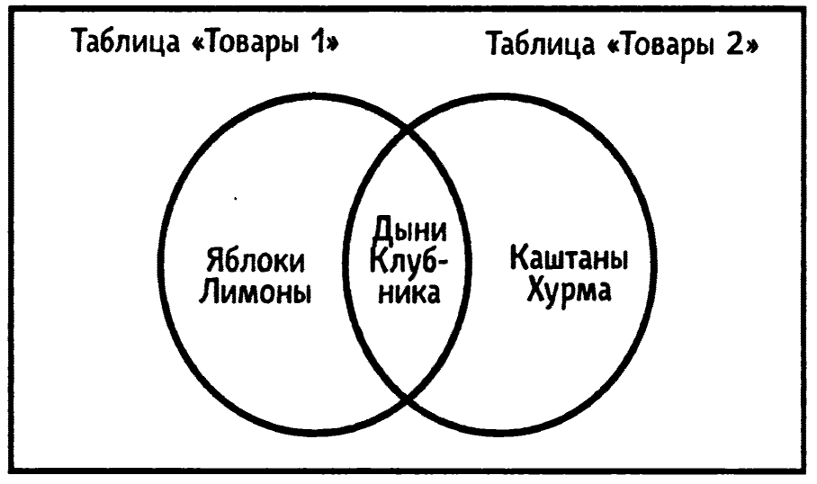

2. **ВЫЧИТАНИЕ (DIFFERENCE)**

Операция Вычитание (DIFFERENCE) извлекает строки только из одной таблицы. Например, с помощью этой операции можно извлечь <u>все товары из первой таблицы, которые не входят во вторую таблицу</u>. Результаты зависят от того, в какой таблице находятся извлекаемые строки и в какой таблице находятся исключаемые строки.

Исходные таблицы "Товары 1" и "Товары 2"
```markdown
Товары 1                     Товары 2
| Название товара | Цена |   | Название товара | Цена |
--------------------------   --------------------------
| Дыни            | 800  |   | Дыни            | 800  |
| Клубника        | 150  |   | Клубника        | 150  |
| Яблоки          | 120  |   | Каштаны         | 200  |
| Лимоны          | 200  |   | Хурма           | 350  |
```
Результат
```markdown
| Название товара | Цена |  | Название товара | Цена |
--------------------------  --------------------------
| Яблоки          | 120  |  | Каштаны         | 200  |
| Лимоны          | 200  |  | Хурма           | 350  |
```
*Дыни и Клубника в результат не попали, т.к. разность множеств оставляет только те элементы Таблицы 1, которых нет в Таблице 2.

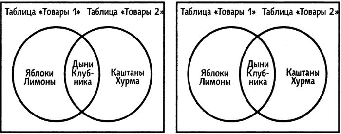

Чтобы не путаться, таблицы **Товары 1** и **Товары 2** можно назвать **A** и **B** соответственно:

**«Разность A − B — это то, что остаётся от A, если убрать всё общее с B».**

Или короче:

**A − B = A минус (A ∩ B)**

То есть из **A** вычитается пересечение **A** и **B**. В примере:
- **A** = {Дыни, Клубника, Яблоки, Лимоны}
- **B** = {Дыни, Клубника, Каштаны, Хурма}
- **A** ∩ B = {Дыни, Клубника}
- **A** − B = {Яблоки, Лимоны}

3. **ПЕРЕСЕЧЕНИЕ (INTERSECTION)**

При помощи пересечения можно также извлекать товары, которые содержаться в <u>обеих таблицах</u>.
```markdown
| Название товара | Цена |
--------------------------
| Дыни            | 800  |
| Клубника        | 150  |
```

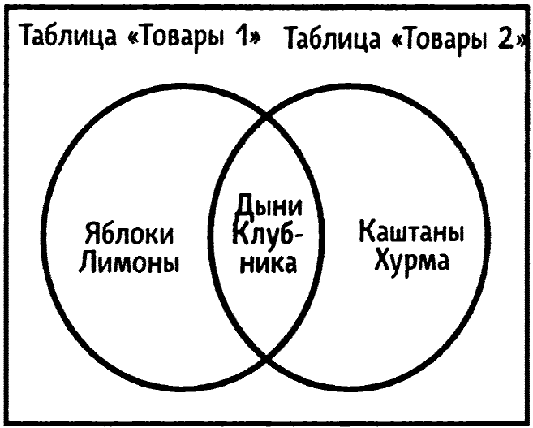

4. **ДЕКАРТОВО ПРОИЗВЕДЕНИЕ (CARTESIAN PRODUCT)**

Операция **CARTESIAN PRODUCT** комбинирует все строки двух таблиц. В этом примере мы получаем `3x3=9` строк.

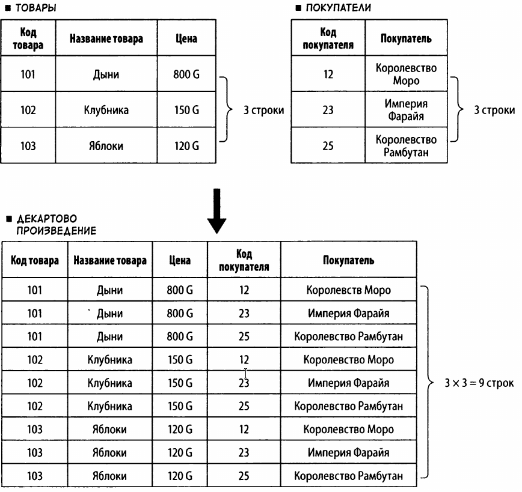

#### Специальные реляционные операции

5. **ПРОЕКЦИЯ (PROJECTION)** <u>извлекает столбцы</u> из таблицы.

```markdown
| Название товара |
-------------------
| Дыни            |
| Клубника        |
| Яблоки          |
| Лимоны          |
```

**Проекция** - это извлечение по вертикали.

6. **ВЫБОРКА (SELECTION)**

Операция **SELECTION** извлекает две <u>строки</u> из таблицы

```markdown
| Название товара | Цена |
--------------------------
| Дыни            | 800  |
| Клубника        | 150  |
```

**Выборка** - это извлечение по горизонтали

7. **СОЕДИНЕНИЕ (JOIN)**

Операция **JOIN** обладает большими возможностями, которые относятся к работе по соединению таблиц.

```markdown
Товары                                   Продажи
| Код товара | Название товара | Цена |  | Дата  | Код товара | Количество |
---------------------------------------  ----------------------------------
| 101        | Дыни            | 800  |  | 01.11 | 102        | 1100       |
| 102        | Клубника        | 150  |  | 01.11 | 101        | 300        |
| 103        | Яблоки          | 120  |  | 05.11 | 103        | 1700       |
| 104        | Лимоны          | 200  |  | 08.11 | 101        | 500        |
```
*Таблица "Продажи" не содержит код 104.

- В этих двух таблицах столбцы "Код товара" дают нам информацию о товаре.
- Первого ноября было продано 1100 клубники (код товара 102).
- Таблица "Продажи" не содержит информации о названии товара, зато в ней есть столбец с кодом этого товара.
- Другими словами, благодаря ссылке на код товара, таблица "Продажи" позволяет нам понять, какой товар был продан.
- В данном случае "Код товара" - это первичный ключ в таблице "Товары" и внешний ключ в таблице "Продажи".
- В результате, объединяя две таблицы таким образом, чтобы внешний ключ ссылался на первичный ключ, получаем следущую таблицу:
```markdown
| Дата | Код товара | Название товара | Цена | Количество |
-----------------------------------------------------------
| 01.11 | 102       | Клубника        | 150  | 1100       |
| 01.11 | 101       | Дыни            | 800  | 300        |
| 05.11 | 103       | Яблоки          | 120  | 1700       |
| 08.11 | 101       | Дыни            | 800  | 500        |
```

8. **ДЕЛЕНИЕ (DIVISION)**

**DIVISION** извлекает строки, где значения в столбцах совпадают со значениями в столбцах во второй таблице, но при этом возвращает столбцы, которых нет во второй таблице

```markdown
Продажи                                  Покупатели
| Код покупателя | Покупатель | Дата  | | Код покупателя | Покупатель |
--------------------------------------  -------------------------------
| 12             | Дания      | 05.03 | | 12             | Дания      |
| 12             | Дания      | 10.03 | | 23             | Испания    |
| 23             | Испания    | 05.03 |
| 25             | Албания    | 21.03 |
| 30             | Камерун    | 25.03 |
```

В результате деления таблицы **"Продажи"** на таблицу **"Покупатели"** получаем результат в виде таблицы, которая позволяет нам найти дату отправки фруктов в оба направления: как в Испанию, так и в Данию:

```markdown
| Дата  |
| 05.03 |
```

- В реляционной БД для извлечения данных можно использовать восемь различных операций.
- Извлёчённые данные представляются в виде временных таблиц.
- Если комбинировать операции, то можно извлекать данные с любыми целями.
- Например, используя цену товара можно получить сводные данные по валовой выручке от продажи.
- Реляционная БД потому и популярна, что обеспечивает гибкую обработку данных.

Ключевая идея: **SQL** - это интерфейс и язык, с помощью которого вы "говорите" с **СУБД**, а она переводит ваши команды в операции с бинарными файлами.

***

**ER (ENTITY-RELATIONSHIP)** - сущность-связь

Нормализация данных - когда существующая таблица не практичка

Сведённые данные всех отчётов в таблицу (сводная таблица, созданная на основе отчёта о продажах):
```markdown
| Код отчёта | Дата  | Код покупателя | Покупатель | Код товара | Название товара | Цена | Кол-во |
---------------------------------------------------------------------------------------------------
| 1101       | 05.03 | 12             | Дания      | 101        | Дыни            | 800  | 1100   |
|            |       |                |            | 102        | Клубника        | 150  | 300    |
| 1102       | 07.03 | 23             | Испания    | 103        | Яблоки          | 120  | 1700   |
| 1103       | 08.03 | 25             | Албания    | 104        | Лимоны          | 200  | 500    |
| 1104       | 10.03 | 12             | Дания      | 101        | Дыни            | 800  | 2500   |
| 1105       | 12.03 | 25             | Албания    | 103        | Яблоки          | 120  | 2000   |
|            |       |                |            | 104        | Лимоны          | 200  | 700    |
```

Какие проблемы у этой таблицы?

1. Дыни, например, в нескольких местах - если понадобится изменить цену дынь, то это придётся делать в нескольких строках;
1. Повторяющиеся данные в таблице - это признак того, что надо разделить таблицу.

Таблицы, которые имеют две или более одинаковые строки данных и которую из-за этого приходится делить, называются **ненормализованные**.

Таблица "Товары" относится только к товарам, чтобы имправить цену только в одной строке:
```markdown
| Дыни     | 800 |
| Клубника | 150 |
| Яблоки   | 120 |
| Лимоны   | 200 |
```

Разделим на таблицу, в которой будут "дата", "код покупателя" и "покупатель".

Таблица "Продажи" (первая нормальная форма (1)).
```markdown
| Код отчёта | Дата  | Код покупателя | Покупатель |
----------------------------------------------------
| 1101       | 05.03 | 12             | Дания      |
| 1102       | 07.03 | 23             | Испания    |
| 1103       | 08.03 | 25             | Албания    |
| 1104       | 10.03 | 12             | Дания      |
| 1105       | 12.03 | 25             | Албания    |
```
Таблица первой нормальной формы создаётся делением ненормаризованной таблицы на другую таблицу, где будут "название товара", "цена", "количество".

Таблица "Реализованные товары" (первая нормальная форма (2)) - данные о реализованных товарах.
```markdown
| Код отчёта | Код товара | Название товара | Цена | Количество |
-----------------------------------------------------------------
| 1101       | 101        | Дыни            | 800  | 1100       |
| 1101       | 102        | Клубника        | 150  | 300        |
| 1102       | 103        | Яблоки          | 120  | 1700       |
| 1103       | 104        | Лимоны          | 200  | 500        |
| 1104       | 101        | Дыни            | 800  | 2500       |
| 1105       | 103        | Яблоки          | 120  | 2000       |
| 1105       | 104        | Лимоны          | 200  | 700        |
```

- Теперь код отчёта есть в обеих таблицах, таким образом определяется связь между обеими таблицами
- Таблица, получившаяся в результате такого разделения, называется таблицей первой нормальной формы.
- Таблица, которая имеет строки с двумя или более одинаковыми данными и которую потом делят, называется ненормализованной формой. Это означает, что таблицы первой нормальной формы создаются делением ненормализированной формы.
- В виде первой нормализованной формы таблицы ещё не могут использоваться как реляционные таблицы БД, потому, что если поступили, например, апельсины, то они в эту таблицу не могут попасть, т.к. ещё не проданы. Если апельсины ещё не продаты, значит нам не известны код отчёта и количество. К тому же в этой таблице перемешаны данные относящиеся к товарам и продажам.
- Таким образом, используя таблицу (2) не возможно управлять данными независимо. Надо её разделить
- Таблицы, которые получились в результате разделения табдицы первой нормальной формы (2) на две.

Таблица "Товары" (вторая нормализированная форма (1)).
```markdown
| Код товара | Название товара | Цена |
---------------------------------------
| 101        | Дыни            | 800  |
| 102        | Клубника        | 150  |
| 103        | Яблоки          | 120  |
| 104        | Лимоны          | 200  |
```
Таблица (1) содержит данные, относящиеся к товарам. Если значение в столбце "код товара" определено, мы можем найти данные в столбцах "название товара" и "цена".

Определям "Первичный ключ"
```markdown
| Код отчёта | Код товара |
```

Делить таблицу нужно так, чтобы при определении первичного ключа значения в других столбцах были определены.
```markdown
  . . . . . . . . . . . . . . . . .
  .               V               V
| Код товара | Название товара | Цена |
```
   ^
 первичный ключ

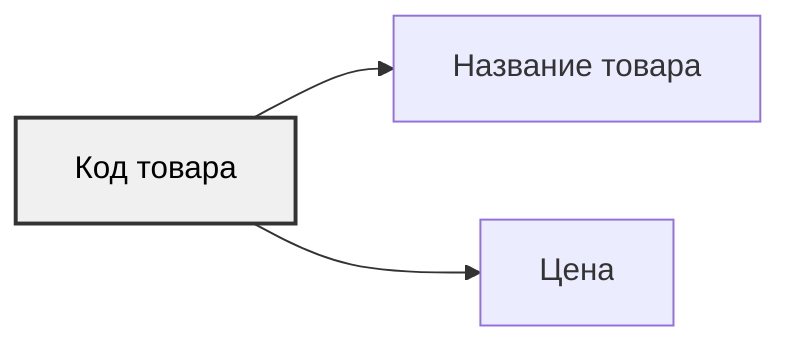

```markdown
  . . . . . . . . . . . . . . . . .
  .               .               V
| Код отчёта | Код товара | Количество |
```
Таблица, которая получается в результате деления по такому правилу, называется таблицей второй нормальной формы.

Таблица "Реализованные товары" (вторая нормализованная форма (2)).
```markdown
| Код отчёта | Код товара | Кол-во |
------------------------------------
| 1101       | 101        | 1100   |
| 1101       | 102        | 300    |
| 1102       | 103        | 1700   |
| 1103       | 104        | 500    |
| 1104       | 101        | 2500   |
| 1105       | 103        | 2000   |
| 1105       | 104        | 700    |
```
Код товара как первичный ключ, который определяет данные в других столбцах.

Теперь можно добавить апельсины в таблицу (1) второй нормальной формы. И если изменится цена на дыни, можно просто скорректировать данные всего в одной строке.

Снова таблица "Продажи" (первая нормальная форма (1)).
```markdown
| Код отчёта | Дата  | Код покупателя | Покупатель |
----------------------------------------------------
| 1101       | 05.03 | 12             | Дания      |
| 1102       | 07.03 | 23             | Испания    |
| 1103       | 08.03 | 25             | Албания    |
| 1104       | 10.03 | 12             | Дания      |
| 1105       | 12.03 | 25             | Албания    |
```
   ^             ^           ^               ^
   .             .  .  . . . . . . . . . . . .
   .                   .
   .                   .
 первичный ключ связан c

Для такой таблицы, если одно значение в столбце определено, то данные в других столбцах тоже определены.

Таблицу, в которой значения в других столбцах определены когда определён первичный ключ, можно считать таблицей второй нормальной формы.

Таблица "Продажи" (вторая нормальная форма (3)).
```markdown
| Код отчёта | Дата  | Код покупателя | Покупатель |
----------------------------------------------------
| 1101       | 05.03 | 12             | Дания      |
| 1102       | 07.03 | 23             | Испания    |
| 1103       | 08.03 | 25             | Албания    |
| 1104       | 10.03 | 12             | Дания      |
| 1105       | 12.03 | 25             | Албания    |
```
Но в этой таблице есть один недостаток - мы не може управлять покупателями!

В таблице "Продажи" (вторая нормальная форма (3)) покупатель определён согласно коду отчёта. Определение кода покупателя определякет значение в столбце "код покупателя", тем самым косвенно опеределяя покупателя.
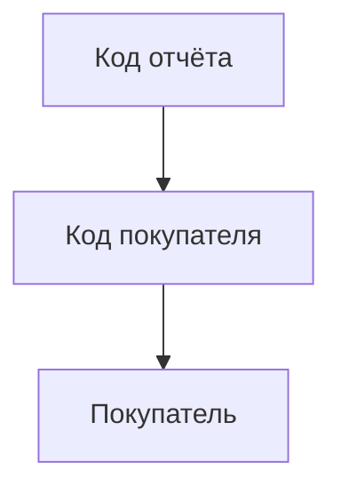
Чтож, придётся снова разделить таблицу, т.к. часто первая и вторая нормализованные формы таблиц являются промежуточными перед окончательным вариантом проектируемой БД.

Таблица "Продажи" (третья нормальная форма (1)).
```markdown
| Код отчёта | Дата  | Код покупателя |
---------------------------------------
| 1101       | 05.03 | 12             |
| 1102       | 07.03 | 23             |
| 1103       | 08.03 | 25             |
| 1104       | 10.03 | 12             |
| 1105       | 12.03 | 25             |
```

Таблица "Покупатели (третья нормальная форма (2))".
```markdown
| Код покупателя | Покупатель |
| 12             | Дания      |
| 23             | Испания    |
| 25             | Албания    |
```

Таблица "Реализованные товары".
```markdown
| Код отчёта | Код товара | Количество |
----------------------------------------
| 1101       | 101        |   1100     |
| 1101       | 102        |   300      |
| 1102       | 103        |   1700     |
| 1103       | 104        |   500      |
| 1104       | 101        |   2500     |
| 1105       | 103        |   2000     |
| 1105       | 104        |   700      |
```

Таблица "Товары".
```markdown
| Код товара | Название товара | Цена |
---------------------------------------
| 101        | Дыня            | 800  |
| 102        | Клубника        | 150  |
| 103        | Яблоко          | 120  |
| 104        | Лимон           | 200  |
```
Всё эти три таблицы получились в результате разделения таблицы до третьей нормальной формы.

Эти таблицы только с виду кажутся отдельными и независимыми друг от друга. На самом деле их крепко объединяют внешние ключи.

**Код покупателя** в таблице "Продажи" ссылается на **код покупателя** в таблице "Покупатель", таким образом **код товара** в таблице "Реализованные товары" ссылается на **код товара** в таблице "Товары" и **код отчёта** в таблице "Реализованные товары" ссылается на **код отчёта** в таблице "Продажи". Таким образом могут быть реализованы связи между таблицами в реалиационной базе данных оп ER-модели (ER - сущьность-связь).

ER-диаграмма **Mermaid**
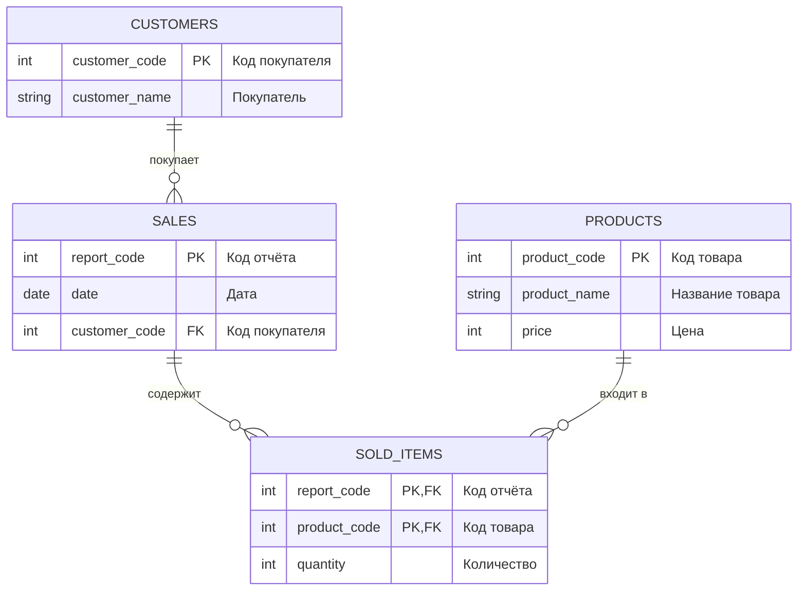
Связи между таблицами

| Связь | Кардинальность | Пояснение |
|-------|----------------|-----------|
| `Покупатели` → `Продажи` | 1:M | Один покупатель может иметь много продаж, но каждая продажа относится к одному покупателю. |
| `Продажи` → `Реализованные товары` | 1:M | Один отчёт о продаже содержит много строк товаров. |
| `Товары` → `Реализованные товары` | 1:M | Один товар может входить во многие строки продаж. |

В таблице **«Реализованные товары»** первичный ключ составной: `(Код отчёта, Код товара)`. Поле `Код отчёта` является внешним ключом к таблице «Продажи», а `Код товара` — внешним ключом к таблице «Товары».

- Обычно в реалиационных БД используют таблицы, разделённые до третьей нормальной формы.
- Теперь, управляя таблицами, вы можете работать с товарами, покупателями и продажами и делать это без каких-либо проблем. Никаких противоречий не возникнет при добавлении данных.
- Таким образом мы разделимли первоначальную таблицу на несколько дополнительных таким образом, что все первоначальные данные входят во все получившиеся таблицы.

Таблица, показывающая отношения между данными называется реляционной.

> **Всегда, когда собираетесь создать базу данных самостоятельно, первым делом надо определить состояние имеющихся данных, которые вы собираетесь использовать для построения новой БД.**

Процесс нормализации приведён ниже:

- Ненормализованная форма (сводная таблица-отчёт)
```markdown
| Код отчёта | Дата | Покупатель | Код товара | Название товара  | Цена | Количнтво |
```
- Первая нормальная форма (**First normal form**)
```markdown
| Код отчёта |  Дата | Код покупателя | Покупатель |
```
```markdown
| Код отчёта | Код товара | Название товара | Цена | Количество |
```
- Вторая нормальная форма (**Second mormal form**)
```markdown
| Код отчёта | Дата | Код покупателя | Покупатель |
```
```markdown
| Код отчёта | Код товара | Количество |
```
```markdown
| Код товара | Название товара | Цена |
```
- Третья нормальная форма (**Third mormal form**)
```markdown
| Код отчёта | Дата | Код покупателя |
```
```markdown
| Код покупателя | Покупатель |
```
```markdown
| Код отчёта | Код товара | Количество |
```
```markdown
| Код товара | Название товара | Цена |
```
* Ненормализованная форма - это таблица, в которой элементы, появляющиеся в ней более одного раза, не могут быть удалены. Управлять данными в реляционной БД с помощью ненормализованной таблицы нельзя. Поэтому её пришлось раздлелить.
* Первая нормальная форма подразумевает простую двумерную таблицу, которая получается в результате разделения первоначальной ненормализованной таблицы. Можно рассматривать её как таблицу с одним элементов в каждой ячейке. Таблица разделена так, что ни один элемент не появится более одного раза.
* Вторая нормальная форма подразумевает таблицу, в которой ключ, обозначающий данные, определяет значения в других таблицах. Т.е. именно первичный ключ определяет значения в других столбцах.
* В реляционной БД значение называется **функционально зависимым**, если оно определяет значения в других столбцах. Во второй нормальной форме таблица делится так, что значения в других столбцах функционально зависят от первичного ключа.
* В третьей нормальной форме таблица делится так, чтобы значение не определялось каким-либо непервичным ключом. В реляционной БД значение называеся **транзитивно зависимым**, если это значение косвенно определяет значения в других столбцах, что является частью функционально зависимой операции. В третьей нормальной форме таблица делится так, что транзитивно зависимые значения удаляются.
* Используйте модель "сущьность-связь", постарайтесь определить, что является сущностью в ваших данных. Сущность - это реально существующий объект в жизни, или вещь, такие как фрукт или покупатель.
* Кроме того, модель "сущность-связь" показывает связь между сущностями. При анализе сводной таблице всех отчётов был выполнен анализ, который показал, что связью между фруктами и покупателями будут выступать продажи. Фрукты экспортируются многим покупателям, в то время как сами покупатели, в свою очередь, импортируют фрукты многих видов. По этой причине для E-R модели был проведён анализ, допускающий, что между фруктами и покупателями существуют свзи, называемые ""многие ко многим". Фрукт М имеет связь с попупателем N. Число связей между сущностями называется **кардинальностью**.

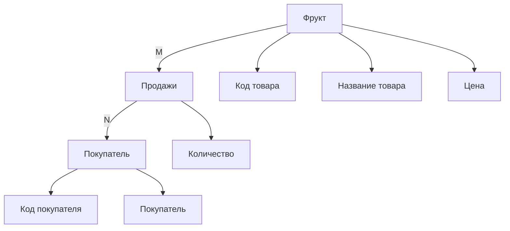

Как анализировать модель "сущность-связь"

Пример 1: связь "один к одному"

Покупатель
   1.
    .
    v
Управление
  1 .
    .
    v
История правок

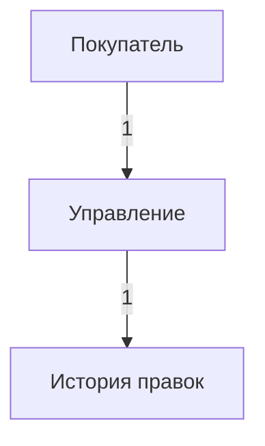

Пример 2: связь "Один ко многим"

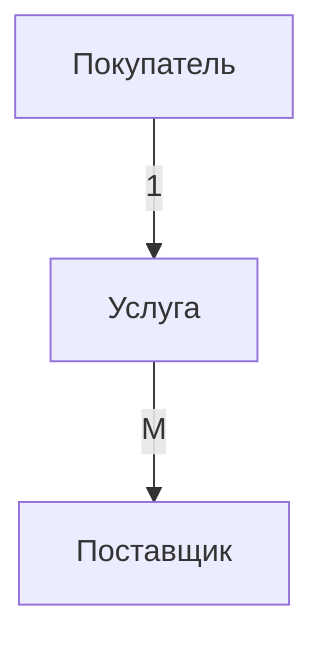

Пример 3: связь "многие ко многим"

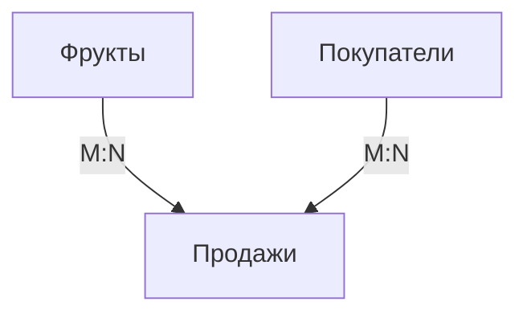

В итоге, при проектировании БД надо сначала определиться, какие данные нам нужны для учёта. Потом составить сводную таблицу этих данных, после определиться, какие опреции на необходимы и уже потом нормализовать сводную таблицу таким образом, чтобы из неё получилось несколько меньших, оптимизированных, для эффективной работы с данными, которые в них содержаться.

### Язык структурированых запросов SQL

Применяя SQL можно "беседовать" с базой данных, выполняя разные задачи: создание таблиц, ввод и извлечение данных, управление пользователями и мн.др.

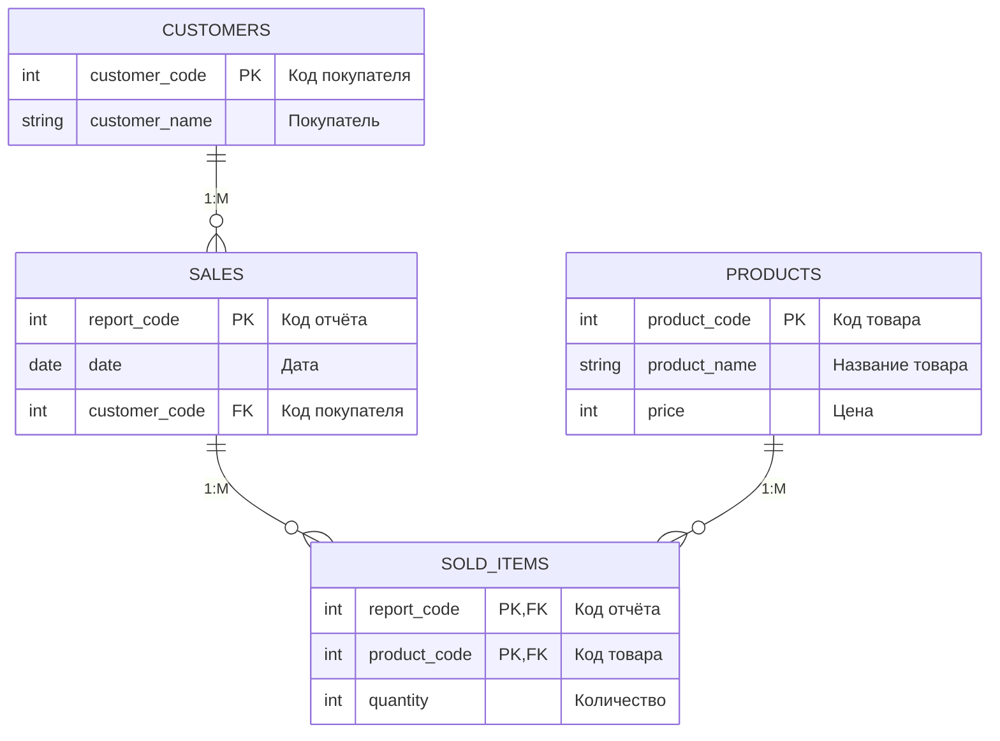

Давайте "попросим" нашу БД дать нам только столбец "Названия товара". На языке SQL эта просьба будет выглядеть так:
```sql
SELECT название_товара
FROM товары;
```
В языке SQL такая просьба называется **командой**. Данная SQL-команда состоит из двух групп: `SELECT НАЗВАНИЕ_ТОВАРА` и `FROM ТОВАРЫ`. В SQL эти группы называются **фразами**. В SQL вы задаёте имя столбца, который хотите получить, с помощью фразы **SELECT**, и имя таблицы, в которой находится этот столбец, с помощью фразы **FROM**.

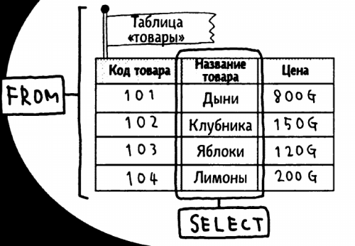

- **Запрос** — это `SELECT` (DQL). Он «спрашивает» данные и получает **набор строк** в ответ.
- **Команда** — это всё остальное: `INSERT`, `UPDATE`, `DELETE`, `CREATE`, `DROP`, `GRANT` и т.д. Они **меняют состояние** базы и обычно не возвращают строк (только статус выполнения).

Таким образом можно получить все названия товаров из таблицы "Товары":
```markdown
| Название товара |
-------------------
| Дыня            |
| Клубника        |
| Яблоко          |
| Лимон           |
```

Используя разные фразы можно получать необходимые данные.

Например, чтобы запросить список товаров с ценой больше или равной 200:
```sql
SELECT *
FROM товары
WHERE цена >= 200;
```
Эта команда извлекает все данные из таблицы "Товары"

Товары, которые стоят 200 или более:
```markdown
| Код товара | Название товара | Цена |
---------------------------------------
| 101        | Дыня            | 800  |
| 104        | Лимон           | 200  |
```
Таким образом, если поменять условие, то можно получить только товары с ценой ниже 200.

Таблица "Товары":
```sql
SELECT *
FROM товары
WHERE цена < 200;
```
Результат:
```markdown
| Код товара | Название товара | Цена |
---------------------------------------
| 102        | Клубника        | 150  |
| 103        | Яблоко          | 120  |
```
Получить из таблицы данные только по яблокам:
```sql
SELECT *
FROM товары
WHERE название_товара = 'яблоки';
```
Результат:
```markdown
| Код товара | Название товара | Цена |
---------------------------------------
| 103        | Яблоко          | 120  |
```
Получить все товары, название которых заканчивается на "а":
```sql
SELECT *
FROM товары
WHERE название_товара LIKE '%а';
```
Результат:
```markdown
| Код товара | Название товара | Цена |
---------------------------------------
| 102        | Клубника        | 150  |
| 202        | Хурма           | 160  |
```

Сортировать извлечённые данные можно фразой **ORDER BY**

Чтобы отсортировать товары по цене в порядке возрастания, добавьте выражение **ORDER BY ЦЕНА**:
```sql
SELECT *
FROM товары
WHERE цена < 200;
ORDER BY цена
```
Результат:
```markdown
| Код товара | Название товара | Цена |
---------------------------------------
| 103        | Яблоко          | 120  |
| 102        | Клубника        | 150  |
```
Получить среднюю цену всех товаров:
```sql
SELECT AVG (цена)
FROM товары;
```
Результат:
```markdown
| Средняя цена |
----------------
|     317      |
```

Агрегатные функции SQL

С их помощью можно получить, например, количество элементов, сумму, среднее, максимальное и минимальные значения и т.п.

- **COUNT (*)** - Получить число строк
- **COUNT (имя_столбца)** - Получить количество непустых ячеек в столбце
- **COUNT (DISTINCT имя_столбца)** - Получить число неодинаковых значений в столбце
- **SUM (имя_столбца)** - Получить сумму значений во всех ячейках столбца
- **AVG (имя_столбца)** - Получить среднее значение в ячейках столбца
- **MAC (имя_столбца)** - Получить максимальное значение в столбце
- **MIN (имя_столбца)** - Получить минимальное значение в столбце

Т.е., чтобы узнать, сколько видов фруктов продаётся, нужно использовать **COUNT**, а чтобы найти товар с максимальной ценой, можно использовать **MAX** и т.д.

Благодаря возможность **SQL** агрегировать данные можно получить кучу полезной информации из ваших таблиц. Кроме этого можно ещё группировать данные для дальнейших с ними действий или анализа.

Но как получить сводные данные из разных таблиц одной базы данных? Так как наша БД уже нормализованна и состоит уже не из одной, а из четырёх таблиц, для построения сводного отчёта придёться соединить эти таблицы (товары, покупатели, продажи и реализованные товары) в одну. Для соединения таблиц в SQL есть условие, чтобы первичный ключ равнялся внешнему ключу, который ссылается на первичный ключ. Соединим таблицы, поствив между ними запятые. Если в таблицах есть одинаковые имена столблов (полей), то заданим их как "названи_таблицы, название_столбца".
```sql
SELECT продажи.код_отчёта,дата,продажи.код_покупателя,покупатель,реализованные_товары.код_товара,
       название_товара,цена,количество
FROM   продажи,реализованные_товары,товары,покупатели
WHERE  продажи.код_отчёта = реализованные_товары.код_отчёта
       AND
       реализованные_товары.код_товара = товары.код_товара
       AND
       покупатели.код_покупателя = продажи.код_покупателя
```
Соединив эти четыре таблицы, необходимо наложить ограничение с помощью **WHERE**. Таким образом можно получить данные отчёта о продажах даже из разделённых таблиц:
```markdown
| Код отчёта | Дата  | Код покупателя | Покупатель | Код товара | Название товара | Цена | Кол-во |
---------------------------------------------------------------------------------------------------
| 1101       | 05.03 | 12             | Дания      | 101        | Дыни            | 800  | 1100   |
|            |       |                |            | 102        | Клубника        | 150  | 300    |
| 1102       | 07.03 | 23             | Испания    | 103        | Яблоки          | 120  | 1700   |
| 1103       | 08.03 | 25             | Албания    | 104        | Лимоны          | 200  | 500    |
| 1104       | 10.03 | 12             | Дания      | 101        | Дыни            | 800  | 2500   |
| 1105       | 12.03 | 25             | Албания    | 103        | Яблоки          | 120  | 2000   |
|            |       |                |            | 104        | Лимоны          | 200  | 700    |
```
Получилась та же самая таблица, которая была в самом начала, до нормализации. Мы как буд-то её воссоздали!

Этим способом можно получить данные, относящиеся к отчёту о продажах, даже если вы работаете с товарами, покупателями и продажами независимо.

Для создания новой таблицы понадобится другая команда - **CREATE TABLE**.
```sql
CREATE TABLE товары
(
код_товара int NOT NULL,
название_товара varchar(255),
цена int,
PRIMARY KEY (код_товара)
);
```
в результате этой команды получиться эта таблица:
```markdown
| Код товара | Название товара | Цена |
---------------------------------------
|            |                 |      |
```
В качестве первичного ключа использовался "код товара". Были определены типы данных для каждого столбца: "код_товара" и "цена" имеют тип данных **int** - для целых чисел. VARCHAR - для текста и 255 это ограничение его длину (на кол-во символов).


Для добавления данных нужо использовать ключевое слово **INSERT**.
```sql
INSERT INTO товары (код_товара, название_товара, цена)
VALUES (101,'дыни',800);
```
Результат:
```markdown
| Код товара | Название товара | Цена |
---------------------------------------
| 101        | Дыни            | 800  |
```

Для удаления данных используется команда **DELETE**, а для обновления **UPDATE**.


Руководства и лабораторные работы по нормализации данных:
- [Нормализация данных. Практическое руководство](/content/Courses/Basics_database_design/content/bd/Normalization.md)
- [Лабораторная # 1 работа по нормализации данных в БД](/content/Courses/Basics_database_design/content/bd/Normalization_1.md)
- [Лабораторная # 2 работа по нормализации данных в БД](/content/Courses/Basics_database_design/content/bd/Normalization_2.md)
- []()

> Если вы обнаружили ошибку в этом тексте - сообщите пожалуйста автору!