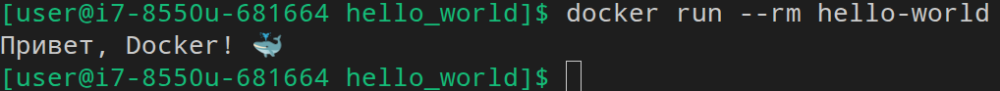

## Dockerfile. Hello-world

- > ## Для выполнения этого задания используйте WSL или любой другой Linux или Mac!
- > Никогда в разработке не используйте русские имена файлов и каталогов!
- > Никогда в разработке не используйте пробелы и спец.символы в именах файлов и каталогов!
- > Перед созданием проекта убедитесь, что порт, который собираетесь использовать не занят другим приложением!
- > Создание проекта лучше начать с "чистого листа", предварительно остановив и удалив все другие контейнеры и образы!

В каталоге для Docker-проектов создайте структуру проекта командой Bash:
```shell
mkdir -p hello-world && touch hello-world/Dockerfile && cd hello-world
```

Содержимое файла `Dockerfile`
```dockerfile
# Используем минимальный базовый образ Alpine Linux
FROM alpine:latest
# Команда, которая выполнится при запуске контейнера
CMD ["echo", "Привет, Docker! 🐳"]
```

В командной строке, находясь в папке `hello-world`, выполнить:
```shell
docker build -t hello-world .
```
> Флаг `-t` задает имя образа

Создание и запуск контейнера:
```shell
docker run --rm hello-world
```



**Результат оформить в виде отдельного `README.md` со скриншотами результатов ваших действий и прислать ссылку преподавателю.**

> Если вы обнаружили ошибку в этом тексте - сообщите пожалуйста автору!
